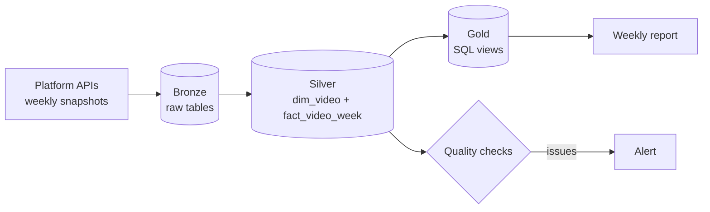

# Video stats — data pipeline

A small **bronze → silver → gold** (medallion) pipeline for short-video stats, written in
plain Python + SQLite. It is the data layer behind the weekly growth report of my
personal-finance video channel, extracted here as a standalone, open project.

> All data in this repo is **synthetic**. No real channel numbers, no API keys.

## Architecture



| Layer | Tables / views | What happens |
|---|---|---|
| Bronze | `video_public_stats`, `video_retention_stats`, `video_catalog` | Raw snapshots, never edited |
| Silver | `silver_dim_video`, `silver_fact_video_week` | One row per video / per snapshot; `LAG()` gives the weekly change in views |
| Gold | `gold_first_week_views_by_pillar`, `gold_retention_by_series`, `gold_views_by_hour` | Report-ready aggregates |

## Data engineering ideas shown

- **Idempotent full reload** inside one transaction — run it twice, get the same result.
- **Window functions** (`LAG ... OVER (PARTITION BY ...)`) for snapshot deltas.
- **Data quality checks**: row parity bronze↔silver, view drops above 2%, freshness, required fields.
- **Outlier guard**: looped videos (retention > 150%) are left out of averages.
- **Time zones**: UTC timestamps converted to local publish hour.

## Run it

```bash
python -m pipeline.sample_data   # builds a demo DB in memory and prints the gold views
pip install pytest && python -m pytest -q
```

## Roadmap

- [ ] DuckDB + Parquet backend
- [ ] dbt-style SQL models
- [ ] Orchestration (Dagster or Airflow)
- [ ] Incremental loads instead of full reload

## License

MIT
